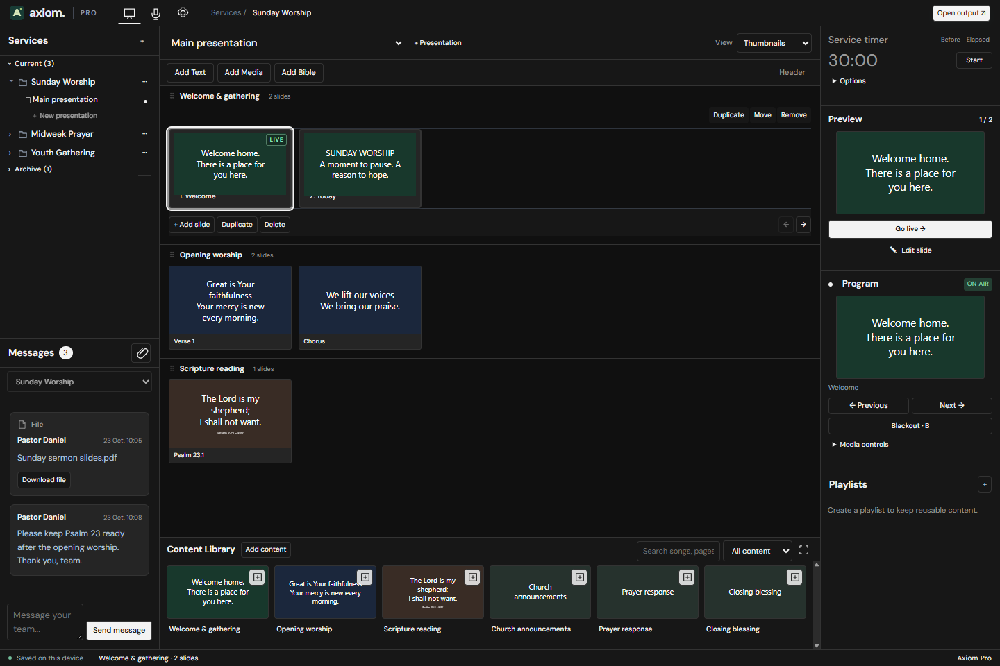
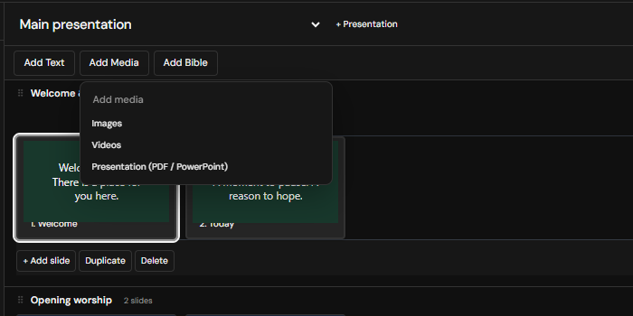
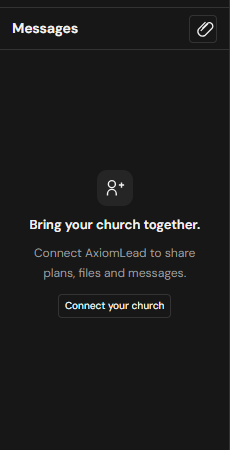

# Axiom Pro design preview

Approved design for the Axiom Pro 0.4.24 web and desktop release. The images below record the reviewed layout.

- Compact Current/Archive service tree with right-click actions and a smaller presentation sublevel.
- Three main add controls: Text (Text/Lyrics), Media (Images/Videos/Presentation), Bible (Passage/AxiomAI Beta).
- Small Header overlay lists the current section arrangement and adds a header. Drag a section heading to reorder.
- Drag slides between sections or library items into a section. Add icons open a service/presentation/section picker. Shared source protection and undo use the existing project engine.
- Expand the library horizontally, resize its width with the side handle, and use the top handle for height.
- Unified Messages with type icons, unread tracking, text hierarchy and a standalone church-connection prompt.
- Compact two-mode service clock, lighter monitors, and settings next to the AI icon. Default proportions are 16% left / 66% middle / 18% right, with a 210px monitor minimum at smaller desktop widths.

## Review images

## Validation

All 76 local tests pass. An isolated Electron preview verified real cross-section slide dragging, library dragging, destination selection, unchanged live output, menus, library widening and keyboard width resizing. Images use illustrative service content.

Desktop release checks now use the new add menus and unified Messages feed. The release workflow verifies both packaged platforms, imports, output, scrolling, messaging and the installed Windows upgrade before publishing installers.
